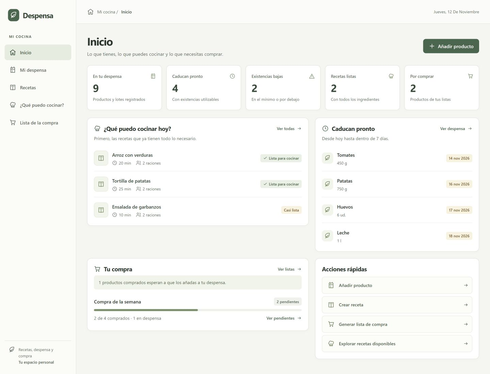
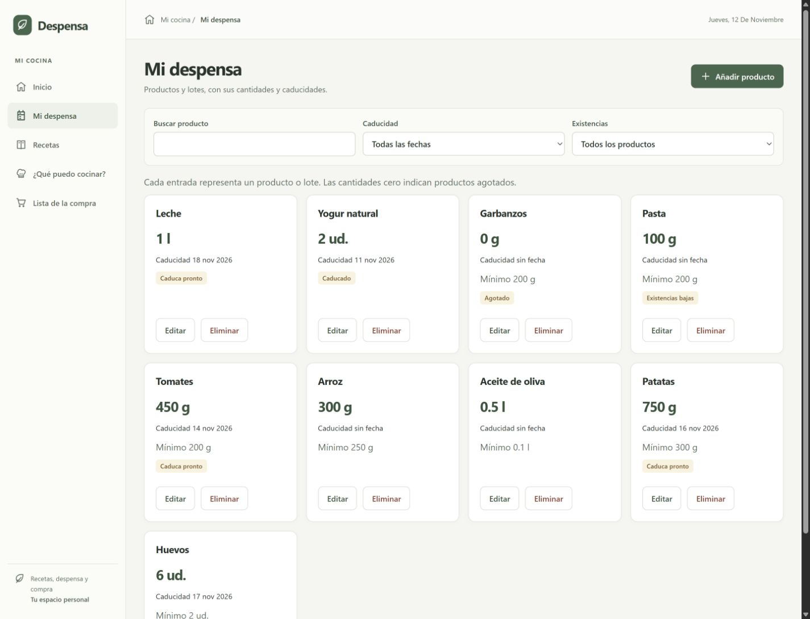
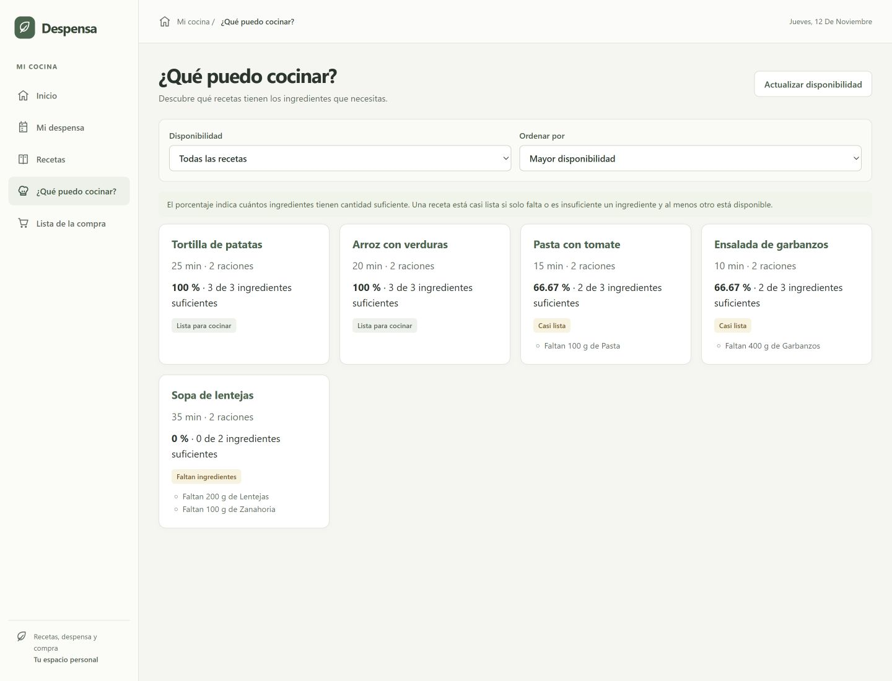
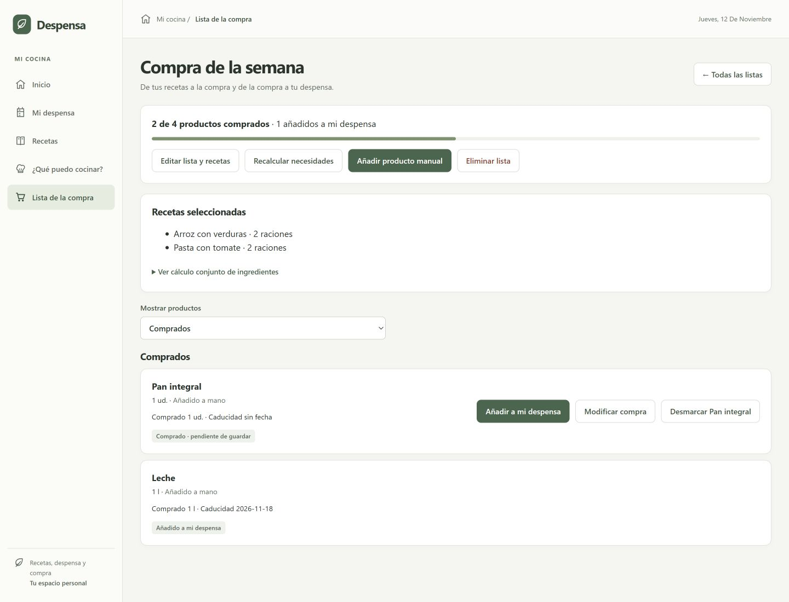
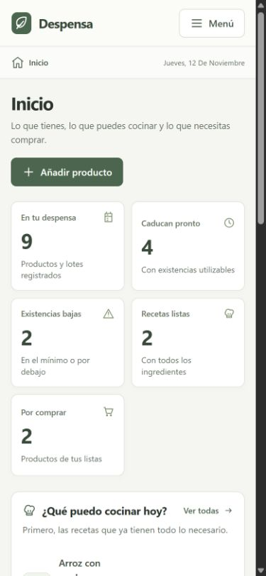

# Despensa

A local kitchen management application that connects recipes, pantry inventory, ingredient availability, and shopping.

Despensa helps answer three practical questions. What do I have? What can I cook? What do I need to buy? Its Spanish interface includes a live dashboard and responsive desktop and mobile navigation. The current application implements V0.5. The V0.6 publication audit adds documentation and submission materials.



## Implemented features

| Area | What works today |
| --- | --- |
| Dashboard | Actual pantry, expiration, minimum-stock, ready-recipe, and shopping statistics, with quick actions |
| Recipes | Create, read, update, delete, and search recipes, including ingredients, quantities, instructions, time, and servings |
| Pantry | Products and batches with quantities, compatible units, optional expiration dates, and minimum-stock thresholds |
| Availability | Ready, almost-ready, and missing-ingredient classifications with required, available, and shortfall quantities |
| Shopping | Persistent lists combining multiple recipes and desired servings, plus manually added products |
| Purchases | Actual purchased quantities, pending/purchased states, and explicit confirmation before transferring stock |
| Reliability | Repeatable migrations, precise Decimal calculations, transactional transfers, and duplicate-transfer prevention |

## Screenshots

These screenshots use synthetic recipes, inventory, and shopping records from a fresh isolated demonstration database. They contain no personal or local development records. Dates and counts illustrate that captured dataset.

<details>
<summary>Pantry inventory</summary>



</details>

<details>
<summary>Recipe availability</summary>



</details>

<details>
<summary>Shopping list and purchase states</summary>



</details>

<details>
<summary>Mobile layout</summary>



</details>

## Technology stack

| Layer | Technology |
| --- | --- |
| Frontend | React, TypeScript, Vite, plain CSS |
| Backend | Python, FastAPI, Pydantic, SQLAlchemy |
| Persistence | SQLite, with additive startup migrations |
| Tests | Pytest and FastAPI TestClient |

## Architecture overview

React calls the FastAPI backend through Vite's local `/api` proxy. SQLAlchemy manages SQLite persistence. Dedicated services normalize ingredients, convert compatible units, evaluate recipe availability, and aggregate shopping requirements.

```text
frontend/src/          Spanish interface, feature views, shared UI and HTTP client
backend/pantrylab/    FastAPI routes, models, schemas, services, and migrations
backend/tests/       Isolated API, migration, persistence, and concurrency tests
docs/screenshots/    Synthetic-data application screenshots
```

Four tables store recipes, inventory entries, shopping lists, and shopping items. Planned requirements, actual purchase quantities, and completed transfers remain distinguishable. The internal Python package retains its original name, pantrylab, to preserve existing startup commands and data paths.

Read [ARCHITECTURE.md](ARCHITECTURE.md) for design decisions and [API.md](API.md) for endpoint contracts.

## Installation

Use Python 3.11 or newer and Node.js 22.12 or newer with npm. The audit used Python 3.12.10 and Node.js 22.23.2.

Clone the repository or use an existing local checkout. These PowerShell commands assume the repository root, regardless of its directory name.

```powershell
git clone https://github.com/RGB-420/despensa.git
Set-Location despensa
python -m venv .venv
.\.venv\Scripts\python.exe -m pip install -r backend\requirements-dev.txt
Push-Location frontend
npm.cmd ci
Pop-Location
```

For an existing checkout, start with `python -m venv .venv` from its root.

## Run locally

Start the backend in one terminal from the repository root.

```powershell
.\.venv\Scripts\python.exe -m uvicorn pantrylab.main:app --app-dir backend --port 8765 --reload
```

Start the frontend in a second terminal from the repository root.

```powershell
Set-Location frontend
npm.cmd run dev
```

Open [the local application](http://localhost:5173) and [interactive API documentation](http://127.0.0.1:8765/docs). These are local development addresses. A production deployment is future work.

For a local production preview, run `npm.cmd run build` followed by `npm.cmd run preview` from the frontend directory while the backend is running.

## Workflow

1. Save recipes with ingredient quantities and servings.
2. Record pantry products or batches and their optional expiration dates.
3. Check which recipes have sufficient usable ingredients.
4. Create a shopping list, select multiple recipes, adjust servings, and add manual products.
5. Record actual purchases with **Registrar compra**.
6. Use **Añadir a mi despensa**, select or create a compatible batch, and confirm.
7. Return to **Inicio** to see updated stock and shopping statistics.

Shopping combines all selected recipe requirements before deducting inventory once. Two recipes requiring two eggs each, with three eggs available, produce a one-egg shopping requirement.

Registering a purchase preserves inventory until the transfer is explicitly confirmed. Transfer and its purchase record commit together. Repeated or concurrent requests add stock only once.

## Data and calculation rules

SQLite uses `backend/data/pantrylab.sqlite3`. Startup applies a repeatable additive migration to schema version 4. Existing recipes, ingredient arrays, and inventory rows remain in place.

Names use case folding, accent removal, normalized whitespace, and explicit aliases. Compatible conversions cover kg/g, l/ml, and individual units. Different measurement dimensions and product descriptions remain separate.

Expired and zero-quantity inventory is excluded from availability. Today and undated products can count. Recipe availability evaluates each recipe independently, while a shopping list aggregates its selected recipes.

Shopping uses Decimal and rounds requirements upward to six decimal places in base units. Recalculation preserves manual items and purchase records. Untransferred, unexpired purchases from that list receive shopping credit. After transfer they count through inventory.

The shared upcoming-expiration window defaults to seven days. Configure `EXPIRATION_WARNING_DAYS` in `backend/pantrylab/config.py`. Dashboard inventory totals count product/batch entries. Low stock means at or below a configured minimum. Shopping counts reflect saved list items, which can be recalculated when stock or recipes change.

## Testing

```powershell
Push-Location backend
..\.venv\Scripts\python.exe -m pytest
Pop-Location
Push-Location frontend
npm.cmd run typecheck
npm.cmd run build
Pop-Location
```

Tests use separate temporary databases. If Windows denies access to its shared temporary directory, use a fresh test-only directory.

```powershell
Push-Location backend
New-Item -ItemType Directory -Force .tmp | Out-Null
$testRun = Join-Path .tmp ([guid]::NewGuid().ToString('N'))
..\.venv\Scripts\python.exe -m pytest --basetemp $testRun -o cache_dir=.tmp/pytest-cache
Pop-Location
```

The publication audit passed all 101 backend tests, TypeScript validation, and the production build. Tests include recipe/inventory regression, repeatable migration, persistence, matching, serving adjustments, transfer concurrency, rollback, and dashboard updates. See [the audit report](docs/AUDIT.md) for scope and the remaining warning.

## Known limitations

- Local, single-user operation, with authentication and household isolation left for future work.
- Lists load without pagination, and ingredient aliases are maintained in code.
- Inventory and actual purchases accept up to six decimal places and eighteen total digits.
- Transferred purchases retain their records and cannot be edited or unmarked. Corrections require an explicit inventory adjustment.
- Separate shopping lists are independent plans and do not reserve stock globally.
- Removing a pending calculated item lasts until the next recalculation.
- Navigation state resets to Inicio on reload, while saved data stays in SQLite.

## Roadmap and contribution opportunities

Future work includes weekly meal planning, consumption tracking, nutrition, household collaboration, authentication, recipe import, improved normalization, budgets, analytics, and production deployment.

[ROADMAP.md](ROADMAP.md) describes the expected technical work and verification criteria for each contribution area. Suitable starting points include targeted frontend tests, pagination, import validation, and accessible interaction improvements.

Discuss a scoped change and the contribution licensing terms with the maintainer, preserve existing data contracts, and run the checks above. Keep matching deterministic and inventory mutations transactional. Database files, credentials, dependencies, and generated output are excluded by .gitignore.

## License

No project license has been selected. Dependency license metadata does not license this application. The confirmed rightsholder must approve any project license.

MIT is a suggested option for broad reuse, including commercial use, with copyright and permission notices retained and a warranty disclaimer. This is a recommendation pending authorization. [MIT license reference](https://choosealicense.com/licenses/mit/)

Public visibility alone does not establish general open-source reuse permissions. [GitHub licensing guidance](https://docs.github.com/en/repositories/managing-your-repositorys-settings-and-features/customizing-your-repository/licensing-a-repository)

## Submission preparation

[ALIGNERR_SUBMISSION.md](ALIGNERR_SUBMISSION.md) contains a factual submission draft with ownership, licensing, and applicant details requiring confirmation. The Alignerr form has not been submitted.
